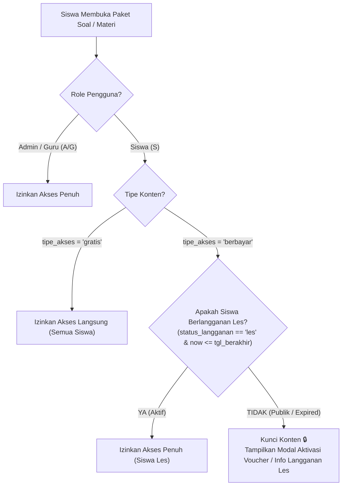

# Dokumen Alur Kerja Teknis: Implementasi Sistem Freemium & Membership Les
**Platform:** CBT & E-Learning Latihan Soal Abdi Praja  
**Dokumen:** Spesifikasi Arsitektur, Skema Database, & Panduan Implementasi Agent  
**Versi:** 1.0 (Freemium & Tutoring Membership Ready)

---

## 1. Ringkasan Eksekutif & Tujuan Fitur

Platform Latihan Soal Abdi Praja akan membuka akses publik secara luas (*Freemium Model*) dengan membedakan konten menjadi **Gratis (Public Trial)** dan **Berbayar (Premium / Khusus Les)**:

1. **Siswa Publik / Umum (Gratis)**:
   - Dapat mendaftar akun sendiri tanpa dipungut biaya.
   - Dapat membuka katalog ujian dan materi pembelajaran.
   - Dapat langsung mengerjakan paket soal & membaca modul materi yang berstatus **Gratis**.
   - Paket berbayar akan berstatus **Terkunci 🔒** dengan penawaran untuk berlangganan les atau aktivasi voucher.
2. **Siswa Berlangganan Les (Membership / Subscriber)**:
   - Merupakan siswa aktif bimbingan belajar Abdi Praja (didaftarkan admin atau aktivasi voucher les).
   - Memiliki status langganan aktif (`status_langganan = 'les'` dan tanggal kedaluwarsa belum lewat).
   - **Bebas mengakses SEMUA paket soal dan materi (baik yang Gratis maupun Berbayar)** tanpa batas.
3. **Admin & Guru**:
   - Menentukan tipe akses (**Gratis** atau **Berbayar**) dan harga nominal pada setiap paket soal dan materi.
   - Dapat mengatur status siswa les secara langsung via menu **Data Siswa** atau melalui penerbitan **Voucher Lisensi**.

---

## 2. Diagram Alur Logika Akses (Access Control Matrix)



---

## 3. Spesifikasi Perubahan Skema Database

Gunakan Laravel Migration (`php artisan make:migration`) untuk menambahkan kolom-kolom baru tanpa merusak data yang sudah ada:

### 3.1. Tabel `soals` (Paket Soal)
```php
Schema::table('soals', function (Blueprint $table) {
    // 'gratis' = bisa dikerjakan publik; 'berbayar' = khusus siswa les / berbayar
    $table->string('tipe_akses', 20)->default('gratis')->after('sub_kategori');
    // Nominal harga untuk tampilan publik (opsional, default 0)
    $table->integer('harga')->nullable()->default(0)->after('tipe_akses');
});
```

### 3.2. Tabel `materis` (Materi Pembelajaran)
```php
Schema::table('materis', function (Blueprint $table) {
    // 'gratis' = bisa dibaca publik; 'berbayar' = modul premium bimbel
    $table->string('tipe_akses', 20)->default('gratis')->after('status');
});
```

### 3.3. Tabel `users` (Status Langganan Siswa)
```php
Schema::table('users', function (Blueprint $table) {
    // 'gratis' = siswa reguler/umum; 'les' = siswa bimbel Abdi Praja
    $table->string('status_langganan', 20)->default('gratis')->after('status');
    // Tanggal batas akhir keanggotaan les
    $table->date('tgl_berakhir_les')->nullable()->after('status_langganan');
});
```

---

## 4. Helper & Relasi Model Eloquent

### 4.1. Model `App\User` (`app/User.php`)
Tambahkan method pemeriksa langganan les:
```php
public function isLanggananLes()
{
    // Admin dan Guru selalu memiliki akses penuh
    if ($this->status == 'A' || $this->status == 'G') {
        return true;
    }

    // Cek apakah status 'les' dan tanggalnya masih berlaku
    if ($this->status_langganan === 'les' && !empty($this->tgl_berakhir_les)) {
        return date('Y-m-d') <= $this->tgl_berakhir_les;
    }

    // Fallback: kompatibilitas dengan voucher lama
    if (!empty($this->voucher)) {
        $voucher = \DB::table('vouchers')->where('id_voucher', $this->voucher)->whereNotNull('used_by')->first();
        if ($voucher) {
            $expiry = date('Y-m-d', strtotime($voucher->used_date . ' + ' . $voucher->masa_berlaku . ' days'));
            return date('Y-m-d') <= $expiry;
        }
    }

    return false;
}
```

### 4.2. Model `App\Models\Soal` (`app/Models/Soal.php`)
```php
public function isGratis()
{
    return empty($this->tipe_akses) || $this->tipe_akses === 'gratis';
}
```

### 4.3. Model `App\Models\Materi` (`app/Models/Materi.php`)
```php
public function isGratis()
{
    return empty($this->tipe_akses) || $this->tipe_akses === 'gratis';
}
```

---

## 5. Tahapan Kerja Implementasi (Pengerjaan Step-by-Step)

### FASE 1: Database Migration & Seeding Default
- Buat file migrasi `database/migrations/2026_10_18_000001_add_freemium_and_membership_columns.php`.
- Jalankan `php artisan migrate`.
- Berikan nilai default:
  - Seluruh paket soal yang ada saat ini di-*seed* `tipe_akses = 'gratis'` untuk paket pengenalan (atau paket ID 8 dsb.) dan `tipe_akses = 'berbayar'` untuk paket simulasi akbar.
  - Akun siswa bimbel yang aktif diatur `status_langganan = 'les'` dan `tgl_berakhir_les = '2026-12-31'`.

### FASE 2: Admin Panel (Pengaturan Tipe Akses Konten)
1. **Form Tambah & Edit Paket Soal**:
   - Lokasi: [`resources/views/soal/index.blade.php`](file:///d:/CBT/yg%20baru/resources/views/soal/index.blade.php) & [`resources/views/guru/soal/form/ubah.blade.php`](file:///d:/CBT/yg%20baru/resources/views/guru/soal/form/ubah.blade.php).
   - Tambahkan input dropdown **Tipe Akses**:
     - `Gratis / Publik (Free Trial)`
     - `Berbayar / Khusus Siswa Les (Premium)`
   - Input **Harga (Rp)** (ditampilkan hanya jika tipe akses 'berbayar').
   - Update Controller: [`app/Http/Controllers/SoalController.php`](file:///d:/CBT/yg%20baru/app/Http/Controllers/SoalController.php) di method `simpanSoal()`.
2. **Form Materi Pembelajaran**:
   - Lokasi: [`resources/views/materi/index.blade.php`](file:///d:/CBT/yg%20baru/resources/views/materi/index.blade.php) & Controller: [`app/Http/Controllers/CrudController.php`](file:///d:/CBT/yg%20baru/app/Http/Controllers/CrudController.php) di `simpanMateri()`.
   - Tambahkan opsi `tipe_akses` (Gratis vs Berbayar).
3. **Manajemen Siswa (Master Siswa)**:
   - Lokasi: [`resources/views/siswa/index.blade.php`](file:///d:/CBT/yg%20baru/resources/views/siswa/index.blade.php) & [`resources/views/siswa/form/ubah.blade.php`](file:///d:/CBT/yg%20baru/resources/views/siswa/form/ubah.blade.php).
   - Tambahkan kolom status member: **Siswa Reguler (Gratis)** vs **Siswa Berlangganan Les (Akses Semua)** beserta input tanggal kedaluwarsa les.

### FASE 3: Portal Siswa (Katalog Ujian & Materi)
1. **Buka Akses Katalog untuk Semua Siswa**:
   - Di [`app/Http/Controllers/SiswaController.php`](file:///d:/CBT/yg%20baru/app/Http/Controllers/SiswaController.php) method `ujian()`:
     - **Hapus penolakan total / tendang ke home** bagi siswa yang belum punya voucher!
     - Biarkan semua siswa membuka halaman [`resources/views/halaman-siswa/ujian.blade.php`](file:///d:/CBT/yg%20baru/resources/views/halaman-siswa/ujian.blade.php).
2. **Tampilan Kartu Paket Soal (`halaman-siswa/ujian.blade.php`)**:
   - **Jika Paket 'Gratis'**:
     - Badge hijau: `🟢 GRATIS / PUBLIK`.
     - Tombol: **Mulai Latihan (Gratis) &rarr;** (dapat langsung diklik siapa saja).
   - **Jika Paket 'Berbayar'**:
     - **Bagi Siswa Les**: Badge emas `👑 AKSES LES AKTIF`, tombol **Mulai Latihan &rarr;**.
     - **Bagi Siswa Umum**: Badge kuning/abu `🔒 KHUSUS SISWA LES` (atau ada label harga misal `Rp 49.000`). Tombol: **Buka Akses / Aktivasi Voucher** yang memunculkan modal aktivasi kode voucher atau kontak pendaftaran les.
3. **Tampilan Materi Pembelajaran (`halaman-siswa/index.blade.php`)**:
   - Tampilkan label `Gratis` atau `👑 Khusus Siswa Les`.
   - Modul gratis dapat langsung dibaca, modul berbayar meminta aktivasi jika siswa belum berlangganan les.

### FASE 4: Proteksi Backend (Security Guarding)
Pastikan backend tidak bisa di-*bypass* melalui URL langsung:
- Di `SiswaController@detailUjian`:
  ```php
  $soal = Soal::findOrFail($id);
  $user = auth()->user();

  // Jika paket berbayar dan siswa bukan siswa les aktif
  if (!$soal->isGratis() && !$user->isLanggananLes()) {
      Session::flash('error', 'Paket latihan ini khusus untuk siswa yang berlangganan les Abdi Praja. Silakan masukkan kode voucher untuk membuka akses.');
      return redirect('/home');
  }
  ```
- Terapkan guard yang sama pada `SiswaController@getSoal` dan `SiswaController@detailMateri`.

### FASE 5: Integrasi dengan Sistem Voucher
- Saat siswa memasukkan kode voucher di Dashboard (`HomeController@vouchers_save` & `CrudController@aktivasi`):
  - Sistem otomatis mengubah `status_langganan = 'les'`.
  - Sistem memperbarui `tgl_berakhir_les = date('Y-m-d', strtotime("+$masa_berlaku days"))`.
  - Dengan demikian, sistem voucher yang sudah ada tetap berfungsi sebagai jalur pembayaran/lisensi offline.

---

## 6. Kriteria Penerimaan & Pengujian (Acceptance Criteria)

1. **Siswa Publik (Belum Langganan)**:
   - Login &rarr; Buka `/siswa/ujian` &rarr; Berhasil terbuka (tidak lagi di-redirect ke home).
   - Klik Paket Gratis &rarr; Ujian langsung mulai berjalan lancar.
   - Klik Paket Berbayar &rarr; Muncul modal peringatan paket khusus les / ajakan aktivasi voucher (tidak bisa mulai ujian).
2. **Siswa Berlangganan Les (Membership Aktif)**:
   - Login &rarr; Buka `/siswa/ujian`.
   - Seluruh paket (Gratis maupun Berbayar) memiliki tombol aktif dan dapat dikerjakan semuanya tanpa halangan.
3. **Admin**:
   - Buat paket soal baru dengan memilih Tipe Akses `Gratis` atau `Berbayar`.
   - Edit paket soal lama untuk mengubah status dari gratis menjadi berbayar (atau sebaliknya).
   - Di Data Siswa, admin dapat menaikkan status siswa umum menjadi `Siswa Les` beserta tanggal masa aktifnya.
4. **Automated Testing**:
   - Buat suite pengujian Playwright: `tests/e2e/freemium_access.spec.js` yang menguji skenario di atas secara otomatis di Desktop dan Mobile.

---
*Dokumen ini siap dijadikan acuan langsung oleh tim developer atau agent AI berikutnya untuk mengimplementasikan fitur tanpa ambiguitas.*
