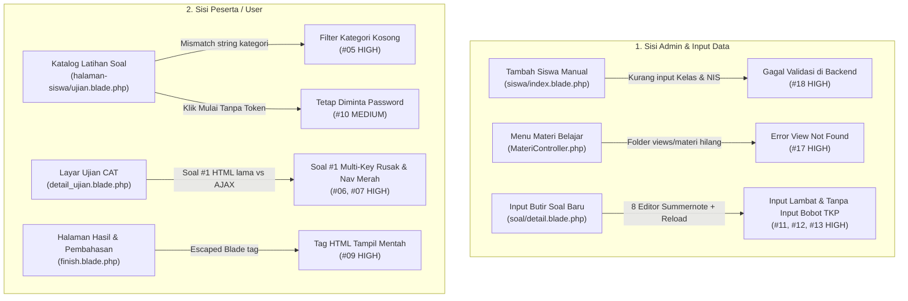

# Laporan Audit UI/UX & Fitur Input: CBT Latihan Soal Abdi Praja

Laporan ini merupakan hasil audit menyeluruh terhadap kode sumber di `d:/CBT/yg baru` yang mencakup 4 fokus utama permintaan Anda:
1. **Kenyamanan & Kesesuaian UI dari Segi Admin/Guru**
2. **Kenyamanan & Kesesuaian UI dari Segi User/Peserta Ujian**
3. **Ergonomi & Fitur Input dalam Membuat Soal serta Jawaban/Pembahasan**
4. **Kenyamanan Membuat Materi & Audit Validasi Fitur Input**

> [!IMPORTANT]
> Audit ini disusun menggunakan standar **Anti-Slop (Mode Audit / After)** dan prinsip ergonomi aplikasi ujian berbasis komputer (CAT/CBT). Setiap temuan diberi nomor urut **`#01` s.d. `#19`** beserta tingkat prioritas (**HIGH**, **MEDIUM**, **LOW**) agar Anda dapat memilih nomor mana saja yang ingin segera diperbaiki.

---

## Peta Alur & Titik Masalah Utama (UX Bottlenecks)

---

## Bagian 1: Audit UI/UX dari Segi Admin & Layout Global

### `#01` [HIGH] Override Ukuran Font & Input Global Terlalu Ekstrem (`R-03`, `R-06`, Aksesibilitas Zoom)
- **Lokasi**: [`app.blade.php`](file:///d:/CBT/yg%20baru/resources/views/layouts/app.blade.php#L40-L99) dan [`app.blade.php`](file:///d:/CBT/yg%20baru/resources/views/layouts/app.blade.php#L225-L234)
- **Masalah**:
  - `body` dipaksa menggunakan `font-size: 18px !important`, `.text-xs` dipaksa naik menjadi `15px !important`, dan `.form-control` dipaksa `height: 54px !important; font-size: 17.5px !important`.
  - Meta viewport menggunakan `maximum-scale=1, user-scalable=no` ([`app.blade.php`](file:///d:/CBT/yg%20baru/resources/views/layouts/app.blade.php#L9)) yang mematikan fitur *pinch-to-zoom* bagi pengguna mobile.
- **Dampak Kenyamanan**:
  - Hierarki visual hilang karena teks label kecil (`.text-xs`), badge status, dan teks isi memiliki ukuran yang hampir sama besar.
  - Pada layar laptop standar Admin (`1366x768`), tabel DataTables menjadi cepat sesak dan memaksa *scroll* berlebih.
  - Aturan `.form-control { height: 54px !important }` ikut mendistorsi tinggi elemen `<select>` dan `<textarea>` standar Bootstrap.
- **Solusi**: Kembalikan skala tipografi ke proporsi ergonomis (`body` `15px` atau `16px`, `.form-control` `min-height: 44px` khusus `input:not(textarea)`), hapus override `!important` pada utility class Tailwind (`.text-xs` s.d. `.text-4xl`), dan izinkan `user-scalable=yes`.

### `#02` [HIGH] Benturan Visual Antara Bootstrap 3 / AdminLTE 2 dan Tailwind CDN (`R-20`, `C-4`)
- **Lokasi**: [`app.blade.php`](file:///d:/CBT/yg%20baru/resources/views/layouts/app.blade.php#L11-L21), [`soal/detail.blade.php`](file:///d:/CBT/yg%20baru/resources/views/soal/detail.blade.php#L10-L85), [`soal/form/ubah.blade.php`](file:///d:/CBT/yg%20baru/resources/views/soal/form/ubah.blade.php#L8-L188)
- **Masalah**: Aplikasi memuat Bootstrap 3.3.6, AdminLTE 2, dan Tailwind Play CDN secara bersamaan. Halaman daftar seperti [`home.blade.php`](file:///d:/CBT/yg%20baru/resources/views/home.blade.php) dan [`soal/index.blade.php`](file:///d:/CBT/yg%20baru/resources/views/soal/index.blade.php) sudah bergaya modern Tailwind (`rounded-3xl`, kartu bersih), tetapi ketika Admin masuk ke detail paket soal ([`soal/detail.blade.php`](file:///d:/CBT/yg%20baru/resources/views/soal/detail.blade.php)) atau edit soal ([`soal/form/ubah.blade.php`](file:///d:/CBT/yg%20baru/resources/views/soal/form/ubah.blade.php)), antarmuka tiba-tiba kembali ke tampilan kaku AdminLTE tahun 2015 (`box box-primary`).
- **Dampak Kenyamanan**: Pengalaman visual terasa terbelah dua (tidak konsisten) saat berpindah halaman, dan pemuatan `` di browser memicu kedipan gaya (*Flash of Unstyled Content*) setiap kali pindah halaman.
- **Solusi**: Seragamkan tampilan halaman kerja Admin (terutama [`soal/detail.blade.php`](file:///d:/CBT/yg%20baru/resources/views/soal/detail.blade.php) dan [`soal/form/ubah.blade.php`](file:///d:/CBT/yg%20baru/resources/views/soal/form/ubah.blade.php)) agar menyatu dengan desain modern kartu `slate/indigo`.

### `#03` [HIGH] Navigasi Sidebar Tidak Menyertakan Menu Materi, Kelas, dan Guru (`R-24`, `R-26`)
- **Lokasi**: [`app.blade.php`](file:///d:/CBT/yg%20baru/resources/views/layouts/app.blade.php#L362-L385) dan [`routes/web.php`](file:///d:/CBT/yg%20baru/routes/web.php#L46-L78)
- **Masalah**: Di sidebar [`app.blade.php`](file:///d:/CBT/yg%20baru/resources/views/layouts/app.blade.php#L365-L383), baik Admin/Guru maupun Siswa tidak memiliki tautan menu menuju **Materi Pembelajaran** (`/elearning/materi` dan `/siswa/materi`), **Data Kelas** (`/master/kelas`), maupun **Data Guru** (`/master/guru`), padahal seluruh rute tersebut ada di [`routes/web.php`](file:///d:/CBT/yg%20baru/routes/web.php).
- **Dampak Kenyamanan**: Fitur Materi dan Manajemen Kelas tidak dapat diakses melalui navigasi normal tanpa mengetik URL secara manual di browser.
- **Solusi**: Tambahkan menu **Materi Belajar** di sidebar Admin/Guru serta Siswa, dan tambahkan menu **Data Kelas & Guru** pada grup Master Data Admin.

### `#04` [MEDIUM] Banner Hero Gelap + Pill Badge Berulang Memakan Ruang Kerja Admin (`R-01`, `R-05`, `R-09`)
- **Lokasi**: [`home.blade.php`](file:///d:/CBT/yg%20baru/resources/views/home.blade.php#L23-L30), [`soal/index.blade.php`](file:///d:/CBT/yg%20baru/resources/views/soal/index.blade.php#L14-L31), [`siswa/index.blade.php`](file:///d:/CBT/yg%20baru/resources/views/siswa/index.blade.php#L15-L43), [`guru/soal/form/ubah.blade.php`](file:///d:/CBT/yg%20baru/resources/views/guru/soal/form/ubah.blade.php#L15-L32)
- **Masalah**: Setiap halaman menggunakan pola template yang sama persis: kotak besar `bg-gradient-to-r from-slate-900 via-slate-800 to-indigo-950 rounded-3xl p-8` ditambah *pill badge* di atas judul (`Manajemen Soal`, `Master Data`, `Edit Paket Latihan`) yang mengulang teks breadcrumb di atasnya.
- **Dampak Kenyamanan**: Pada halaman operasional Admin, banner dekoratif ini menghabiskan hampir sepertiga layar vertikal sebelum Admin bisa melihat tabel data atau formulir kerja.
- **Solusi**: Pertahankan banner sambutan hanya di Dashboard utama ([`home.blade.php`](file:///d:/CBT/yg%20baru/resources/views/home.blade.php)), sedangkan pada halaman kerja internal (`soal`, `siswa`, `laporan`, `materi`) gunakan *compact action header* satu baris (Judul + deskripsi singkat di kiri, tombol aksi utama di kanan).

---

## Bagian 2: Audit UI/UX dari Segi User / Peserta Ujian

### `#05` [HIGH] Tombol Filter Kategori di Katalog Soal Siswa Tidak Berfungsi (`R-26`, `C-2`)
- **Lokasi**: [`halaman-siswa/ujian.blade.php`](file:///d:/CBT/yg%20baru/resources/views/halaman-siswa/ujian.blade.php#L60-L70), [`halaman-siswa/ujian.blade.php`](file:///d:/CBT/yg%20baru/resources/views/halaman-siswa/ujian.blade.php#L99-L111), dan [`soal/index.blade.php`](file:///d:/CBT/yg%20baru/resources/views/soal/index.blade.php#L60-L63)
- **Masalah**:
  - Tombol filter di [`halaman-siswa/ujian.blade.php`](file:///d:/CBT/yg%20baru/resources/views/halaman-siswa/ujian.blade.php#L64-L69) mengirimkan string `'kedinasan'` atau `'sma'`, lalu memfilter kartu dengan perbandingan eksak `cardCategory === activeCategory` ([L194](file:///d:/CBT/yg%20baru/resources/views/halaman-siswa/ujian.blade.php#L194)).
  - Padahal saat Admin membuat paket soal di [`soal/index.blade.php`](file:///d:/CBT/yg%20baru/resources/views/soal/index.blade.php#L60-L63), nilai `kategori_utama` yang disimpan ke database adalah `'Kedinasan & Polri (SKD BKN/Akademik)'` atau `'SMA & UTBK (SNBT)'`.
- **Dampak Kenyamanan**: Begitu siswa menekan tombol filter **Kedinasan & Polri** atau **SMA & UTBK-SNBT**, seluruh paket soal buatan Admin tersembunyi dan muncul pesan *"Paket Soal Tidak Ditemukan"*.
- **Solusi**: Normalisasi perbandingan kategori di [`halaman-siswa/ujian.blade.php`](file:///d:/CBT/yg%20baru/resources/views/halaman-siswa/ujian.blade.php#L99-L111) (misalnya memeriksa apakah string mengandung kata `'sma'` / `'utbk'` vs `'kedinasan'`), sehingga badge warna dan tombol filter bekerja akurat untuk data lama maupun baru.

### `#06` [HIGH] Inkonsistensi Markup Soal Nomor 1 vs Nomor Lainnya Saat Ujian Berlangsung (`C-4`, `R-26`)
- **Lokasi**: [`halaman-siswa/detail_ujian.blade.php`](file:///d:/CBT/yg%20baru/resources/views/halaman-siswa/detail_ujian.blade.php#L109-L156) vs [`halaman-siswa/get_soal.blade.php`](file:///d:/CBT/yg%20baru/resources/views/halaman-siswa/get_soal.blade.php#L20-L80)
- **Masalah**:
  - Saat ujian pertama kali dimulai, Soal #1 di-render langsung di dalam [`detail_ujian.blade.php`](file:///d:/CBT/yg%20baru/resources/views/halaman-siswa/detail_ujian.blade.php#L112-L154) dengan markup tabel lama: tidak memiliki pembungkus `.opsi-container[data-tipe]`, tidak menampilkan badge tipe soal (`Pilihan Ganda` / `Pilihan Ganda Kompleks` / `Soal TKP`), tidak menampilkan bobot poin, dan tidak memuat state `.dijawab` jika sebelumnya sudah terisi.
  - Sebaliknya, ketika siswa mengklik nomor soal di panel navigasi, soal dimuat via AJAX menggunakan [`get_soal.blade.php`](file:///d:/CBT/yg%20baru/resources/views/halaman-siswa/get_soal.blade.php) yang memiliki struktur modern lengkap.
- **Dampak Kenyamanan**: Apabila Soal #1 merupakan soal *Multi-Key* (Pilihan Ganda Kompleks), siswa tidak melihat instruksi bahwa soal tersebut bisa dipilih lebih dari satu, dan klik opsi pada tampilan awal hanya berfungsi sebagai pilihan tunggal karena atribut `data-tipe="multi"` pada `.opsi-container` tidak ada.
- **Solusi**: Gunakan partial view yang sama (`@include('halaman-siswa.get_soal', ['soal' => $soals->first()])`) untuk merender Soal #1 pada [`detail_ujian.blade.php`](file:///d:/CBT/yg%20baru/resources/views/halaman-siswa/detail_ujian.blade.php#L109-L156) agar tampilan dan logika interaksi 100% konsisten dari detik pertama.

### `#07` [HIGH] Ergonomi Panel Navigasi Nomor Soal & Absennya Fitur "Ragu-ragu" (`R-25`, `R-27`, `C-4`)
- **Lokasi**: [`halaman-siswa/detail_ujian.blade.php`](file:///d:/CBT/yg%20baru/resources/views/halaman-siswa/detail_ujian.blade.php#L90-L229) dan [L532-L552](file:///d:/CBT/yg%20baru/resources/views/halaman-siswa/detail_ujian.blade.php#L532-L552)
- **Masalah**:
  1. Seluruh tombol nomor soal yang belum dijawab menggunakan kelas `btn-danger` (merah menyala). Dalam psikologi antarmuka ujian, warna merah mengesankan jawaban salah atau peringatan bahaya.
  2. Status warna hijau (`btn-success`) hanya berubah saat opsi diklik di sesi tersebut; jika halaman dimuat ulang, nomor yang sudah pernah dijawab kembali berwarna merah.
  3. Tidak ada penanda visual (ring/outline/warna biru) untuk menunjukkan **nomor soal yang sedang aktif dibuka** saat ini.
  4. Tidak ada tombol **"Ragu-ragu" (Tandai Kuning / `btn-warning`)** yang sangat dibutuhkan peserta saat mengerjakan soal SKD/UTBK untuk menandai soal yang ingin ditinjau kembali.
  5. Saat masuk mode layar penuh (`#specialstuff`), latar belakang kontainer tidak didefinisikan secara eksplisit sehingga pada beberapa browser dapat tampak gelap/hitam atau tata letaknya terlalu rapat ke tepi layar.
- **Solusi**:
  - Gunakan warna netral (`bg-slate-100 text-slate-700`) untuk soal belum dijawab, biru/indigo ber-outline tegas untuk soal yang sedang dibuka, kuning (`amber`) untuk soal ditandai **Ragu-ragu**, dan hijau (`emerald`) untuk soal yang sudah dijawab.
  - Inisialisasi warna tombol nomor dari relasi `checkJawab` sejak awal pemuatan halaman.

### `#08` [HIGH] Auto-Submit Terlalu Sensitif Tanpa Peringatan & Posisi Tombol "Batalkan Ujian" Rawan Salah Klik (`C-4`)
- **Lokasi**: [`halaman-siswa/detail_ujian.blade.php`](file:///d:/CBT/yg%20baru/resources/views/halaman-siswa/detail_ujian.blade.php#L169-L173) dan [L397-L419](file:///d:/CBT/yg%20baru/resources/views/halaman-siswa/detail_ujian.blade.php#L397-L419)
- **Masalah**:
  - Apabila peserta tidak sengaja menekan tombol `Esc` (keluar dari fullscreen) atau muncul notifikasi sistem operasi yang memicu `visibilitychange`, fungsi `kirimJawaban()` langsung terpanggil dan mengakhiri ujian detik itu juga tanpa dialog peringatan.
  - Tombol `#keluar` (**Batalkan Ujian**) diletakkan tepat di sebelah tombol **Selesai**, dan ketika diklik langsung menghapus seluruh jawaban (`batalUjian()`) tanpa dialog konfirmasi.
- **Solusi**:
  - Tambahkan dialog konfirmasi sebelum menjalankan **Batalkan Ujian**, dan pisahkan posisinya agar tidak berdekatan dengan tombol navigasi **Sebelumnya / Selanjutnya**.
  - Berikan peringatan modal (*warning counter* 1-2 kali atau tombol "Kembali ke Layar Penuh") saat keluar fullscreen sebelum memaksa *auto-submit*.

### `#09` [HIGH] Tag HTML pada Pembahasan Cepat & Konseptual Tampil Mentah di Halaman Hasil (`C-2`)
- **Lokasi**: [`halaman-siswa/finish.blade.php`](file:///d:/CBT/yg%20baru/resources/views/halaman-siswa/finish.blade.php#L192-L197) dan [L208-L213](file:///d:/CBT/yg%20baru/resources/views/halaman-siswa/finish.blade.php#L208-L213)
- **Masalah**: Di [`finish.blade.php`](file:///d:/CBT/yg%20baru/resources/views/halaman-siswa/finish.blade.php#L193), kode menggunakan `{{ $item->pembahasan_cepat }}` dan `{{ $item->pembahasan_konsep }}` (escaped output), padahal Admin menulis pembahasan tersebut menggunakan editor HTML Summernote di [`soal/detail.blade.php`](file:///d:/CBT/yg%20baru/resources/views/soal/detail.blade.php#L203).
- **Dampak Kenyamanan**: Siswa melihat tag HTML mentah seperti `
<b>Trik:</b> Eliminasi opsi A...
 ` di layar evaluasi hasil ujian.
- **Solusi**: Ubah menjadi `{!! $item->pembahasan_cepat !!}` dan `{!! $item->pembahasan_konsep !!}` serta hapus `whitespace-pre-line` pada kontainer HTML agar jarak paragraf `
` dari Summernote tidak menjadi ganda.

### `#10` [MEDIUM] Peserta Tetap Diminta Password Meskipun Paket Soal "Tanpa Token" (`R-26`)
- **Lokasi**: [`SiswaController.php`](file:///d:/CBT/yg%20baru/app/Http/Controllers/SiswaController.php#L136-L158) dan [`halaman-siswa/ujian.blade.php`](file:///d:/CBT/yg%20baru/resources/views/halaman-siswa/ujian.blade.php#L149)
- **Masalah**: Di [`SiswaController@detailUjian`](file:///d:/CBT/yg%20baru/app/Http/Controllers/SiswaController.php#L143-L157), sistem mewajibkan URL memiliki parameter `$key == hash("sha256", $soal->password . Auth::user()->id)` bahkan ketika `$soal->password` bernilai kosong (`null` atau `""`).
- **Dampak Kenyamanan**: Ketika Admin mengosongkan kolom Password Token agar soal bisa langsung dikerjakan, siswa yang mengklik **Mulai Latihan** tetap dihadang oleh halaman input password kosong (`password_ujian.blade.php`).
- **Solusi**: Di [`SiswaController@detailUjian`](file:///d:/CBT/yg%20baru/app/Http/Controllers/SiswaController.php#L145), jika `empty($soal->password)`, langsung izinkan siswa masuk ke halaman briefing ujian tanpa melewati gerbang password.

---

## Bagian 3: Audit Kenyamanan Membuat Soal & Jawaban (Sisi Pembuat Soal)

### `#11` [HIGH] Tipe Soal "TKP Berbobot (Skala 1-5)" Tidak Memiliki Input Skor Opsi A-E & Belum Dihitung (`C-2`, `R-26`)
- **Lokasi**: [`soal/detail.blade.php`](file:///d:/CBT/yg%20baru/resources/views/soal/detail.blade.php#L106-L108), [`soal/form/ubah.blade.php`](file:///d:/CBT/yg%20baru/resources/views/soal/form/ubah.blade.php#L33-L36), dan [`SiswaController.php`](file:///d:/CBT/yg%20baru/app/Http/Controllers/SiswaController.php#L215-L246)
- **Masalah**:
  - Pembuat soal dapat memilih radio button **TKP Berbobot (Skala Nilai 1-5)**, dan tabel `detailsoals` sudah memiliki kolom `bobot_opsi` (serta [`SoalController@simpanDetailSoal`](file:///d:/CBT/yg%20baru/app/Http/Controllers/SoalController.php#L275-L277) sudah siap menerima `$request->bobot_opsi`).
  - Namun di form UI ([`soal/detail.blade.php`](file:///d:/CBT/yg%20baru/resources/views/soal/detail.blade.php#L309-L317) dan [`soal/form/ubah.blade.php`](file:///d:/CBT/yg%20baru/resources/views/soal/form/ubah.blade.php#L202-L210)), memilih radio `tkp` hanya menampilkan input Kunci Jawaban Tunggal biasa! Tidak ada input bagi Admin untuk menentukan bobot poin tiap opsi (`A = 5, B = 4, C = 3, D = 2, E = 1`).
  - Di [`SiswaController@jawab`](file:///d:/CBT/yg%20baru/app/Http/Controllers/SiswaController.php#L239-L246) dan [`finish.blade.php`](file:///d:/CBT/yg%20baru/resources/views/halaman-siswa/finish.blade.php#L107-L112), soal `tkp` juga belum mengambil poin dari `bobot_opsi[pilihan]`.
- **Dampak Kenyamanan**: Admin tidak dapat membuat soal TKP SKD BKN yang sesungguhnya (di mana setiap opsi A s.d. E memiliki poin 1 s.d. 5 tanpa ada yang bernilai 0).
- **Solusi**: Tambahkan panel input khusus `#form-wrap-kunci-tkp` yang muncul saat tipe `tkp` dipilih (berisi input angka bobot 1-5 untuk opsi A, B, C, D, E), lalu perbarui logika penilaian `tkp` di [`SiswaController@jawab`](file:///d:/CBT/yg%20baru/app/Http/Controllers/SiswaController.php#L239) dan tampilan skor di [`finish.blade.php`](file:///d:/CBT/yg%20baru/resources/views/halaman-siswa/finish.blade.php).

### `#12` [HIGH] Bug Konflik Input `name="kunci"` (Single) vs `name="kunci[]"` (Multi) Saat Disimpan (`C-2`)
- **Lokasi**: [`soal/detail.blade.php`](file:///d:/CBT/yg%20baru/resources/views/soal/detail.blade.php#L153-L178) dan [`soal/form/ubah.blade.php`](file:///d:/CBT/yg%20baru/resources/views/soal/form/ubah.blade.php#L94-L121)
- **Masalah**: Fungsi `toggleFormTipeSoal()` hanya menyembunyikan div dengan `.hide()`, tetapi tidak memberikan atribut `disabled` pada `<input name="kunci">` atau `<input name="kunci[]">` yang sedang disembunyikan. Karena keduanya berada di dalam `<form id="form-soal">` yang sama dan di-serialize dengan `$("#form-soal").serialize()`, input radio `kunci=A` (yang secara default `checked`) tetap ikut terkirim bersama `kunci[]`.
- **Solusi**: Saat berganti tipe soal (`single`, `multi`, `tkp`), nonaktifkan (`prop('disabled', true)`) input kunci pada grup yang disembunyikan dan aktifkan (`prop('disabled', false)`) hanya pada grup yang aktif.

### `#13` [HIGH] Ergonomi Form Pembuatan Butir Soal: 8 Editor Summernote Bertumpuk & Reload Penuh Setiap Simpan
- **Lokasi**: [`soal/detail.blade.php`](file:///d:/CBT/yg%20baru/resources/views/soal/detail.blade.php#L74-L231) dan [L327-L394](file:///d:/CBT/yg%20baru/resources/views/soal/detail.blade.php#L327-L394)
- **Masalah**:
  1. Form pembuatan soal diletakkan di dalam kolom `col-md-8`, lalu di dalamnya dibagi lagi menjadi `col-sm-3` (label) dan `col-sm-9` (editor), sehingga lebar area ketik soal menjadi sempit.
  2. Terdapat **8 instance editor Summernote** yang langsung aktif sekaligus dalam 1 halaman (Soal, Pilihan A, B, C, D, E, Trik Cepat, Pembahasan Konsep). Hal ini membuat halaman menjadi sangat panjang ke bawah dan toolbar berulang 8 kali.
  3. Saat Admin menekan **Simpan Butir Soal**, script melakukan `window.location.reload()` ([L383](file:///d:/CBT/yg%20baru/resources/views/soal/detail.blade.php#L383)) yang menutup kembali form `#wrap-soal`. Jika Admin ingin menginput 50 soal, Admin harus mengklik tombol "Tambah Butir Soal" 50 kali dari awal.
  4. Saat mengedit soal di [`soal/form/ubah.blade.php`](file:///d:/CBT/yg%20baru/resources/views/soal/form/ubah.blade.php#L242), setelah klik Simpan, Admin diarahkan ke `elearning/soal/detail/data-soal/{id}` (halaman preview satuan), bukan kembali ke daftar butir soal paket (`elearning/soal/detail/{id_soal}`).
- **Solusi Ergonomi**:
  - Gunakan tata letak *stacked* (label di atas editor, lebar penuh 100%) dan tata kartu Info Paket di bagian atas secara ringkas agar daftar & form butir soal mendapat lebar penuh (`col-md-12`).
  - Gunakan toolbar ringkas (*compact toolbar*) untuk Pilihan A s.d. E (tinggi `70px`), dan toolbar lengkap untuk Pertanyaan Soal serta Pembahasan.
  - Saat berhasil menyimpan butir soal baru, cukup muat ulang DataTable (`table_soal.ajax.reload()`), kosongkan isi editor (`$('.textarea').summernote('code', '')`), dan sediakan opsi **"Simpan & Buat Soal Lagi"** tanpa me-reload seluruh halaman.

### `#14` [HIGH] Belum Ada Dukungan Rumus Matematika (KaTeX) & Upload Gambar Menyimpan Base64 Raksasa
- **Lokasi**: [`app.blade.php`](file:///d:/CBT/yg%20baru/resources/views/layouts/app.blade.php), [`soal/detail.blade.php`](file:///d:/CBT/yg%20baru/resources/views/soal/detail.blade.php#L327-L340)
- **Masalah**:
  - Untuk soal TIU Numerik, Фиsika, dan Penalaran Matematika UTBK, pembuat soal membutuhkan penulisan pecahan, akar, pangkat, atau persamaan matematika ($\frac{a}{b}$, $\sqrt{x}$, $\int$). Saat ini belum ada library perender rumus (seperti KaTeX) di layout.
  - Ketika pembuat soal menyisipkan gambar di Summernote, Summernote secara default mengubah file gambar menjadi string teks `data:image/png;base64,...` berukuran ratusan kilobyte langsung di dalam kolom database `soal`.
- **Dampak Kenyamanan**: Database cepat membengkak, tabel daftar soal di Admin menjadi lambat dimuat, dan rumus matematika sulit diketik dengan rapi.
- **Solusi**:
  - Pasang **KaTeX** (auto-render ringan untuk sintaks `$...$` dan `$$...$$`) beserta panduan singkat penulisan rumus di bawah editor soal.
  - Tambahkan endpoint upload gambar Summernote agar gambar soal disimpan sebagai file di `public/assets/img/soal/` dan hanya URL-nya yang disimpan di database.

### `#15` [MEDIUM] Input Durasi Paket Soal Menggunakan Satuan Detik & Tidak Ada Input KKM (`C-2`)
- **Lokasi**: [`soal/index.blade.php`](file:///d:/CBT/yg%20baru/resources/views/soal/index.blade.php#L74-L76), [`guru/soal/form/ubah.blade.php`](file:///d:/CBT/yg%20baru/resources/views/guru/soal/form/ubah.blade.php#L67-L70), [`SoalController.php`](file:///d:/CBT/yg%20baru/app/Http/Controllers/SoalController.php#L200-L235)
- **Masalah**:
  - Admin harus menginput durasi ujian dalam satuan **Detik** (misalnya harus menghitung `100 x 60 = 6000` detik).
  - Seluruh halaman peserta menampilkan nilai **KKM / Passing Grade** (`$soal->kkm ?? 70`), tetapi di form Buat Paket maupun Edit Paket tidak ada kolom input untuk mengatur nilai KKM tersebut.
- **Solusi**: Ubah input durasi bagi Admin menjadi satuan **Menit** (atau sediakan input Menit yang otomatis mengisi nilai Detik), dan tambahkan input **Passing Grade / KKM** pada form paket soal.

### `#16` [HIGH] Fitur Import Soal via Excel Hilang dari UI & Menggunakan Fungsi Usang (`C-2`)
- **Lokasi**: [`soal/detail.blade.php`](file:///d:/CBT/yg%20baru/resources/views/soal/detail.blade.php#L76-L83) dan [`SoalController.php`](file:///d:/CBT/yg%20baru/app/Http/Controllers/SoalController.php#L306-L378)
- **Masalah**:
  - Tombol untuk membuka form Import Soal via Excel tidak ada di [`soal/detail.blade.php`](file:///d:/CBT/yg%20baru/resources/views/soal/detail.blade.php), padahal controller [`simpanDetailSoalExcel`](file:///d:/CBT/yg%20baru/app/Http/Controllers/SoalController.php#L306) dan view hasil upload sudah tersedia.
  - Kode di [`SoalController@simpanDetailSoalExcel`](file:///d:/CBT/yg%20baru/app/Http/Controllers/SoalController.php#L315) masih memanggil `Excel::load(...)` yang sudah dihapus pada paket `maatwebsite/excel: ^3.1`, sehingga jika dipanggil akan menghasilkan *Fatal Error*.
- **Solusi**: Tambahkan tombol & panel *Import Soal Excel* beserta unduh template di [`soal/detail.blade.php`](file:///d:/CBT/yg%20baru/resources/views/soal/detail.blade.php), dan perbarui logika import di [`SoalController.php`](file:///d:/CBT/yg%20baru/app/Http/Controllers/SoalController.php#L306) agar kompatibel dengan Maatwebsite Excel 3.1 / PhpSpreadsheet serta mendukung kolom `pembahasan_cepat` dan `pembahasan_konsep`.

---

## Bagian 4: Audit Pembuatan Materi & Fitur Input Lainnya

### `#17` [HIGH] Modul Materi Belajar (Admin & Siswa) Rusak karena View dan Metode Controller Hilang (`C-2`, `R-24`)
- **Lokasi**: [`MateriController.php`](file:///d:/CBT/yg%20baru/app/Http/Controllers/MateriController.php#L16-L69), [`SiswaController.php`](file:///d:/CBT/yg%20baru/app/Http/Controllers/SiswaController.php), [`routes/web.php`](file:///d:/CBT/yg%20baru/routes/web.php#L73-L78), dan [`routes/web.php`](file:///d:/CBT/yg%20baru/routes/web.php#L113-L115)
- **Masalah**:
  1. **Sisi Admin/Guru**: [`MateriController.php`](file:///d:/CBT/yg%20baru/app/Http/Controllers/MateriController.php#L16) memiliki salah ketik `public function __controller()` (seharusnya `__construct()`), dan me-return `view('materi.index')`, `view('materi.detail')`, serta `view('materi.form.ubah')`. Namun **direktori `resources/views/materi/` tidak ada** di dalam repositori.
  2. **Sisi Siswa**: Rute `/siswa/materi`, `/siswa/data-materi`, dan `/siswa/materi/detail/{id}` memanggil `SiswaController@materi`, `SiswaController@dataMateri`, dan `SiswaController@detailMateri`, tetapi **ketiga fungsi tersebut tidak ada di dalam [`SiswaController.php`](file:///d:/CBT/yg%20baru/app/Http/Controllers/SiswaController.php)** (walaupun file view [`halaman-siswa/index.blade.php`](file:///d:/CBT/yg%20baru/resources/views/halaman-siswa/index.blade.php) dan [`halaman-siswa/detail_materi.blade.php`](file:///d:/CBT/yg%20baru/resources/views/halaman-siswa/detail_materi.blade.php) sudah ada).
- **Dampak Kenyamanan**: Admin sama sekali tidak bisa membuat/mengelola materi, dan siswa yang membuka halaman materi akan mengalami error `Method does not exist`.
- **Solusi**:
  - Buat halaman manajemen dan editor materi (`resources/views/materi/index.blade.php`, `detail.blade.php`, `form/ubah.blade.php`) dengan editor kaya fitur (teks, gambar cover, dukungan rumus/video/link modul).
  - Tambahkan metode `materi()`, `dataMateri()`, dan `detailMateri()` pada [`SiswaController.php`](file:///d:/CBT/yg%20baru/app/Http/Controllers/SiswaController.php).

### `#18` [HIGH] Form Tambah & Edit Siswa Gagal Berfungsi karena Input Wajib (`id_kelas`, `no_induk`) Tidak Ada di Form (`C-2`)
- **Lokasi**: [`siswa/index.blade.php`](file:///d:/CBT/yg%20baru/resources/views/siswa/index.blade.php#L56-L95), [`CrudController.php`](file:///d:/CBT/yg%20baru/app/Http/Controllers/CrudController.php#L273-L301), dan [`SiswaController.php`](file:///d:/CBT/yg%20baru/app/Http/Controllers/SiswaController.php#L56-L65)
- **Masalah**:
  - Di [`siswa/index.blade.php`](file:///d:/CBT/yg%20baru/resources/views/siswa/index.blade.php#L56-L84), form `#form-siswa` hanya memiliki 3 input: `nama`, `email`, dan `jk`.
  - Namun saat tombol **Simpan Siswa** diklik, [`CrudController@simpanSiswa`](file:///d:/CBT/yg%20baru/app/Http/Controllers/CrudController.php#L277-L280) menolak request jika `id_kelas` atau `no_induk` kosong (*"Kelas tidak boleh kosong."*).
  - Selain itu, pada [`siswa/index.blade.php`](file:///d:/CBT/yg%20baru/resources/views/siswa/index.blade.php#L68), placeholder email menggunakan contoh generik `budi@example.com` (`R-23`/`R-38`).
  - Saat Admin mengklik tombol **Ubah** pada baris siswa (`siswa/edit/{id}`), [`SiswaController@editSiswa`](file:///d:/CBT/yg%20baru/app/Http/Controllers/SiswaController.php#L56-L65) tidak mengirimkan variabel `$kelas` ke [`siswa/form/ubah.blade.php`](file:///d:/CBT/yg%20baru/resources/views/siswa/form/ubah.blade.php), sehingga memicu error crash `Undefined variable: kelas`.
- **Solusi**: Tambahkan input **NIS / Nomor Peserta (`no_induk`)** dan pilihan **Kelas / Kelompok (`id_kelas`)** (atau jadikan opsional di backend untuk sistem Bimbel mandiri), serta kirimkan `$kelas = Kelas::get()` pada [`SiswaController@editSiswa`](file:///d:/CBT/yg%20baru/app/Http/Controllers/SiswaController.php#L56).

### `#19` [MEDIUM] Filter Input Angka `.numOnly` Memblokir Copy-Paste & Menggunakan `keyCode` Usang (`R-32`)
- **Lokasi**: [`app.blade.php`](file:///d:/CBT/yg%20baru/resources/views/layouts/app.blade.php#L436-L445)
- **Masalah**: Handler `.numOnly` pada event `keydown` hanya mengizinkan `Ctrl+A` (`keyCode === 65`), sehingga pengguna tidak dapat melakukan `Ctrl+V` (paste angka), `Ctrl+C` (copy), atau `Ctrl+X` pada semua field angka.
- **Solusi**: Izinkan kombinasi tombol pintas clipboard (`Ctrl/Cmd + C, V, X, Z`) dan tambahkan pembersihan karakter non-angka pada event `input` agar tetap aman saat pengguna melakukan *paste*.

---

## Ringkasan Prioritas Perbaikan

| Nomor | Area | Temuan | Prioritas |
| :--- | :--- | :--- | :--- |
| **`#01`** | Admin & Global UI | Override CSS font (`18px`) & tinggi `.form-control` (`54px`) terlalu ekstrem + zoom terkunci | **HIGH** |
| **`#02`** | Admin & Global UI | Inkonsistensi desain AdminLTE 2 lama vs Tailwind modern pada halaman Detail/Edit Soal | **HIGH** |
| **`#03`** | Navigasi Global | Menu Materi Belajar (Admin & Siswa) serta Kelas/Guru tidak ada di Sidebar | **HIGH** |
| **`#04`** | Admin UI | Hero banner gelap berulang di tiap halaman kerja memakan ruang vertikal | **MEDIUM** |
| **`#05`** | User / Peserta UI | Filter kategori (`Kedinasan` / `SMA`) di Katalog Soal Siswa gagal mencocokkan data | **HIGH** |
| **`#06`** | User / Peserta UI | Soal #1 saat ujian memakai markup lama (Multi-Key tidak jalan di Soal #1) | **HIGH** |
| **`#07`** | User / Peserta UI | Navigasi nomor soal berwarna merah (`btn-danger`), tidak sinkron saat reload, & tanpa tombol "Ragu-ragu" | **HIGH** |
| **`#08`** | User / Peserta UI | Auto-submit keluar fullscreen tanpa peringatan & tombol "Batalkan Ujian" tanpa konfirmasi | **HIGH** |
| **`#09`** | User / Peserta UI | Tag HTML pada Pembahasan Cepat & Konsep tampil mentah (`
`, `<b>`) di halaman Hasil | **HIGH** |
| **`#10`** | User / Peserta UI | Paket soal tanpa password tetap memunculkan halaman input password | **MEDIUM** |
| **`#11`** | Input Soal & Jawaban | Tipe soal "TKP Berbobot 1-5" belum punya input poin per opsi A-E & belum dihitung di backend | **HIGH** |
| **`#12`** | Input Soal & Jawaban | Konflik serialisasi input `kunci` vs `kunci[]` saat ganti tipe soal | **HIGH** |
| **`#13`** | Input Soal & Jawaban | 8 editor Summernote bertumpuk di kolom sempit & reload penuh setiap simpan 1 soal | **HIGH** |
| **`#14`** | Input Soal & Jawaban | Belum ada perender rumus matematika (KaTeX) & gambar Summernote masih berupa Base64 di DB | **HIGH** |
| **`#15`** | Input Paket Soal | Input durasi masih dalam Detik (bukan Menit) & belum ada input Passing Grade (KKM) | **MEDIUM** |
| **`#16`** | Input Soal Massal | Tombol Import Soal via Excel hilang dari UI & fungsi backend memakai `Excel::load()` usang | **HIGH** |
| **`#17`** | Input & Baca Materi | Fitur Materi rusak: folder `resources/views/materi` hilang & metode di `SiswaController` belum ada | **HIGH** |
| **`#18`** | Input Data Siswa | Form Tambah Siswa selalu gagal validasi (`id_kelas` & `no_induk` tidak ada di form) & Edit Siswa crash | **HIGH** |
| **`#19`** | Komponen Input | Script `.numOnly` memblokir `Ctrl+C` / `Ctrl+V` (paste angka) | **MEDIUM** |
